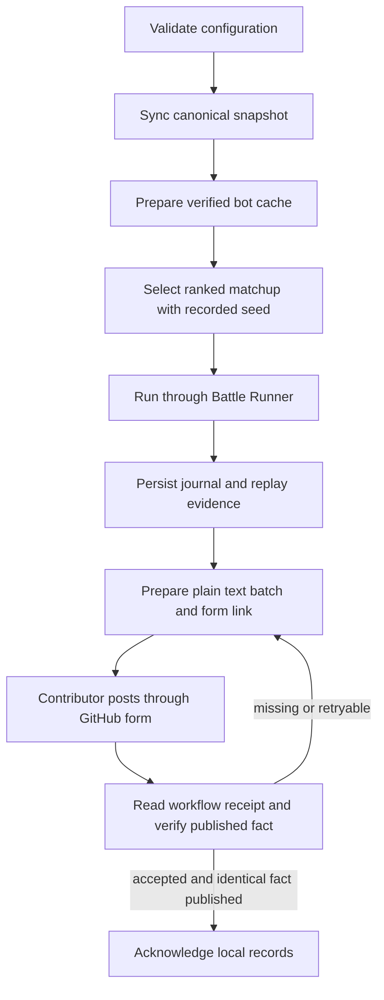

# Design

The client follows a snapshot-first workflow. It validates local configuration, resolves the canonical ranked input snapshot, verifies the engine pin and catalog data, hashes each cached bot source tree against its declared digest, selects a recorded-seed matchup, executes one battle, and persists the result and replay evidence locally before submission.

## Operational flows

Synchronization reads repository contracts and materializes an immutable cache at the catalog's exact source commit. Selection prioritizes under-sampled pairings involving `myBots`, falls back to distinct active catalog entries when advice is unavailable, and records the random seed so the decision can be reproduced. Game-type expansion determines how many catalog entries are required, and selection rejects entries that share a member bot.

Battle execution is delegated to the pinned Tank Royale Battle Runner. The container image carries the supported Java, .NET, Python, and Node.js runtimes; launcher scripts provide the isolation and resource limits needed for reviewed-but-untrusted bot archives. The runtime preflight reports missing prerequisites without installing them.

The local work directory is the durable boundary for the bot cache, journal, replay evidence and prepared submissions. Submission writes bounded plain text batches and short form links; the contributor posts each batch while signed in to GitHub. The read-only Issues transport scans the registered account's issues across pages and correlates the prepared title and JSON envelope. Receipt collection accepts comments from the GitHub Actions bot and independently checks each result against a fresh canonical repository checkout, reading raw facts or compacted monthly rollups and matching the submitted account and complete payload. Records remain pending through network errors, API limits and delayed publication. In-flight state is calculated per issue attempt so an old rejection cannot hide a newer open retry; prepared titles remain unique across restarts, including retries within the same clock millisecond. A single oversized record fails preparation while remaining in the journal. Server-side idempotency protects already published facts when a submission is repeated.

<!-- clue:index:start -->
<!-- clue:index:end -->
